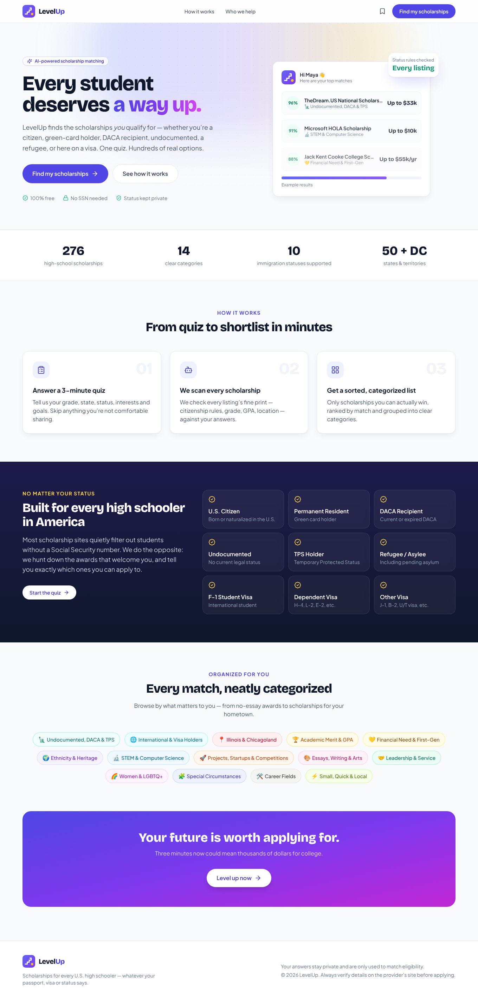
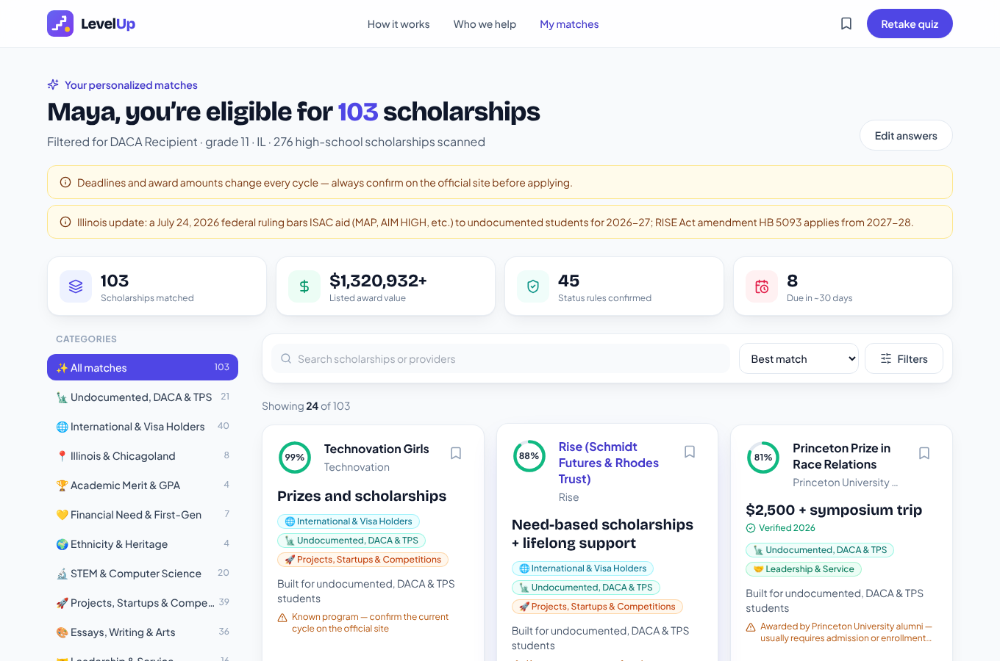

# LevelUp — Scholarships for Every Student

LevelUp finds scholarships for every U.S. high schooler — citizens, green-card holders,
DACA recipients, undocumented students, TPS holders, refugees/asylees, and F-1 / dependent /
other visa holders.

Students take a 6-step questionnaire; the API filters the scholarship dataset down to awards
they're actually eligible for, ranks them, explains each match, and flags anything they should
double-check (unconfirmed citizenship rules, local residency, college-specific awards, etc.).





## Quick start

```bash
npm install
npm run dev        # API on :8787 + web app on :5173 (Vite proxies /api to the API)
```

Production (one process serves the API and the built web app):

```bash
npm run build      # typecheck + build the web app into dist/
npm start          # http://localhost:8787
```

See `.env.example` for configuration (`PORT`, `DATA_FILE`, `CORS_ORIGIN`, `VITE_API_URL`).

## Project layout

```
src/        React + TypeScript + Tailwind web app
server/     Express API
  data/scholarships.json   the scholarship dataset (source of truth)
  normalize.ts             turns the dataset's free text into structured fields
  match.ts                 eligibility filter + ranking
  report.ts                prints how every record was parsed (npm run data:report)
  index.ts                 HTTP endpoints
shared/     types and option lists used by both sides
```

## API

| Method | Path | Description |
|---|---|---|
| `POST` | `/api/match` | Body `{ profile: StudentProfile }` → `{ results, scanned, notices, dataGenerated }` |
| `GET` | `/api/stats` | Dataset counts (total, high-school eligible, per category) |
| `GET` | `/api/scholarships?category=STEM&q=robot` | Browse high-school-eligible scholarships |
| `GET` | `/api/scholarships/:id` | One normalized record |
| `GET` | `/api/health` | Liveness check |

`StudentProfile`, `MatchedScholarship` and the other shapes are in `shared/types.ts`. Profile
fields are validated against the known option lists; `grade`, `state` and `status` are required.

## Updating the scholarship data

Replace `server/data/scholarships.json` with a file in the same format (`meta` +
`scholarships[]` with `id, name, provider, amount, max_amount_usd, deadline, grade_level,
min_gpa, citizenship_code, citizenship, location, category_codes, categories, url,
verification, notes, last_checked`), then run:

```bash
npm run data:report
```

It prints what every `grade_level`, `location` and `deadline` value parsed to and which
requirements were detected, so you can spot anything the rules don't handle yet. Add new
cases to the rule tables in `server/normalize.ts`.

### How the free-text fields are interpreted

| Field | Interpretation |
|---|---|
| `grade_level` | Mapped to high-school grades 9–12 plus "gap year". College-, graduate-, adult- and middle-school-only awards (e.g. "UG, GR", "Law students", "Grades 5–8") are excluded from matching. |
| `citizenship_code` | `ANY` → everyone · `UNDOC` → undocumented/DACA/TPS · `DACA` → citizen/PR/DACA · `INTL` → visa holders + DACA · `CPR` → citizen/PR/refugee-asylee · `CHECK` → shown to everyone, with a "confirm citizenship rules" warning (and a lower rank) for non-citizens |
| `location` | Whole states and known cities/counties/districts → state codes (sub-state places are flagged "local"). Colleges ("Harvard", "UC Berkeley") are national but flagged as requiring admission. |
| `deadline` | Exact dates are kept; "Typically March", "Dec–Jan", seasons etc. become an **estimated** next date (shown with "~" in the UI); "Rolling"/"Monthly" are rolling; "Varies" has no date. |
| `amount` / `max_amount_usd` | Text is shown as-is; `max_amount_usd` is used for sorting, totals and the minimum-amount filter (awards without a number are never filtered out). |
| name + notes | Keyword rules detect heritage, women-only, LGBTQ+, special-circumstance (military family, foster care, disability…) and membership (FFA, DECA, Eagle Scouts…) requirements. |

Hard filters: grade, status, state, GPA, minimum amount, required circumstances, heritage (only
when the student shared theirs) and women-only awards (only when the student is male). Everything
else affects ranking or shows up as a warning.
